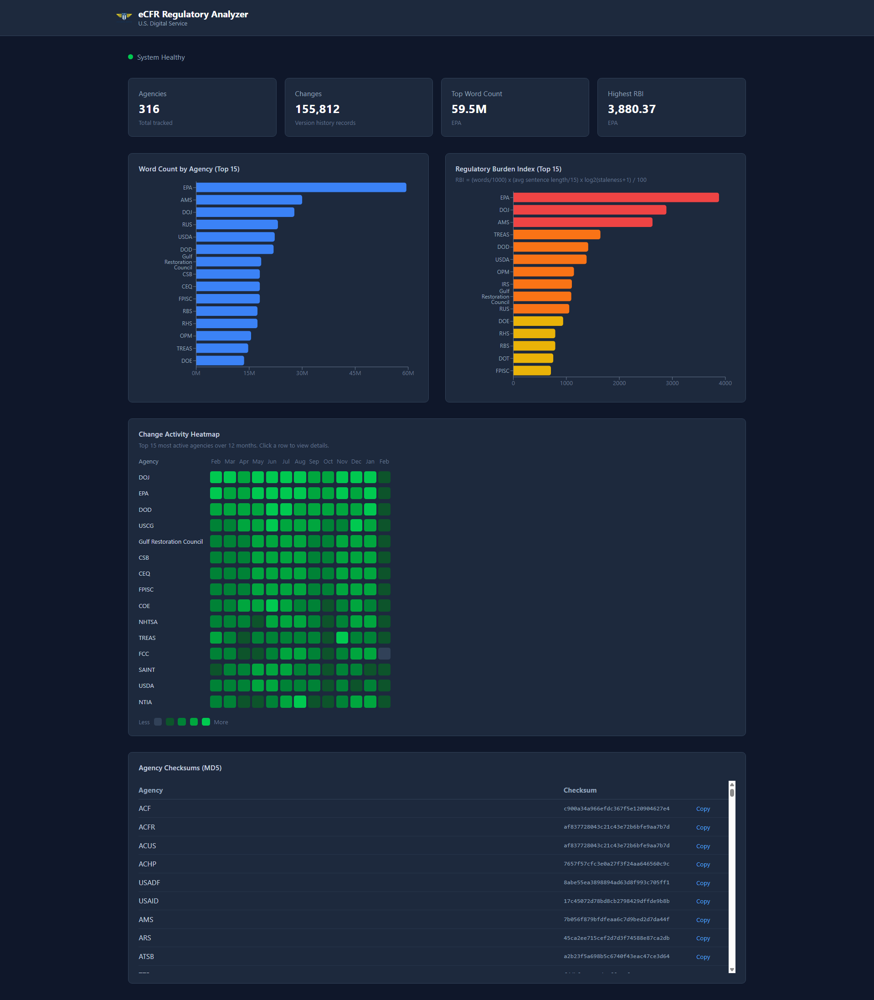
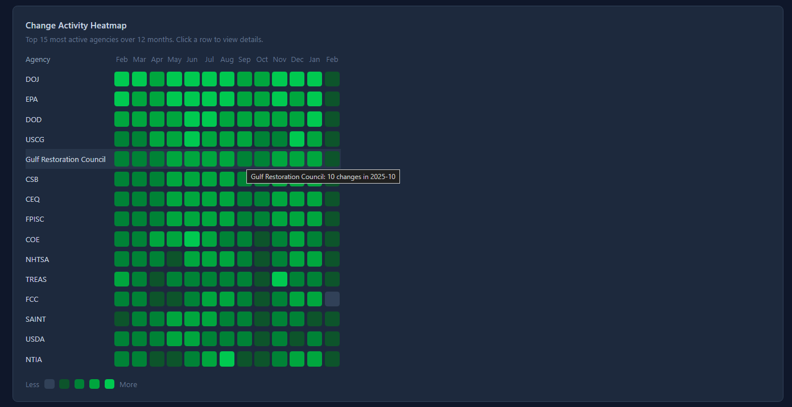
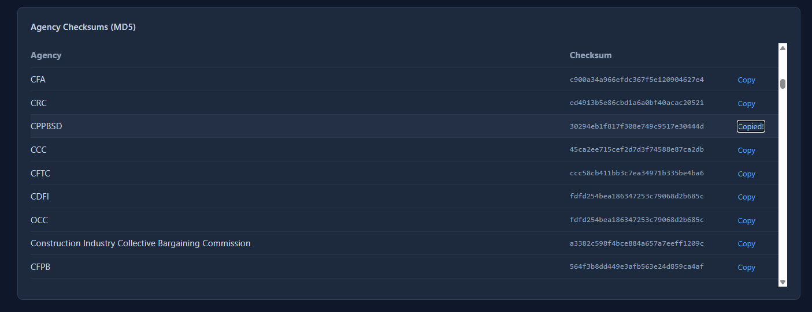
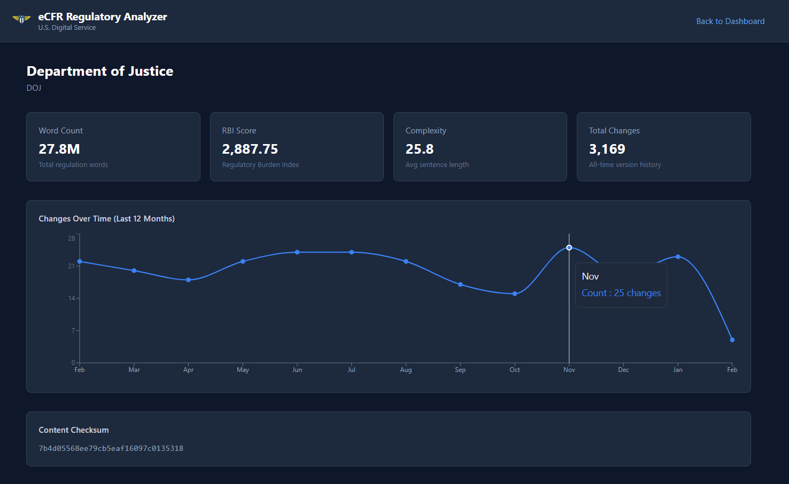

# eCFR Regulatory Analyzer

A web application that downloads, stores, and analyzes federal regulation data from the [eCFR public API](https://www.ecfr.gov/). Built for the U.S. Digital Service.

## What It Does

Provides a dashboard for analyzing federal regulations across ~150 agencies with four key metrics:

1. **Word Count per Agency** - Horizontal bar chart showing regulation volume by agency
2. **Historical Changes Over Time** - GitHub-style heatmap of change activity across 12 months
3. **Checksum per Agency** - MD5 content hashes with one-click copy for integrity verification
4. **Regulatory Burden Index (RBI)** - Custom metric combining word count, sentence complexity, and staleness into a single score per agency

## Screenshots



| Change activity heatmap | Agency checksums |
|---|---|
|  |  |



## Tech Stack

- **Backend**: ASP.NET Core 9 Minimal API, EF Core 9, SQLite
- **Frontend**: React 19, Vite, Tailwind CSS v4, Recharts
- **Data Source**: eCFR public API (no authentication required)

## Running Locally

### Prerequisites

- [.NET 9 SDK](https://dotnet.microsoft.com/download/dotnet/9.0)
- [Node.js 20+](https://nodejs.org/) and npm

### Backend

```bash
cd backend
dotnet run
```

The API server starts at `http://localhost:5000`. On first launch, it automatically syncs agency and regulation data from the eCFR API (this takes several minutes).

### Frontend

```bash
cd frontend
npm install
npm run dev
```

Opens at `http://localhost:5173`. The Vite dev server proxies `/api` requests to the backend.

## API Endpoints

| Method | Path | Description |
|--------|------|-------------|
| GET | `/api/health` | System status, sync info, record counts |
| GET | `/api/agencies` | List all agencies (sortable by `words`, `rbi`, `name`) |
| GET | `/api/agencies/{slug}` | Agency detail with monthly change breakdown |
| GET | `/api/analytics/word-counts` | Top N agencies by word count |
| GET | `/api/analytics/burden-index` | Top N agencies by RBI score |
| GET | `/api/analytics/heatmap` | Agency x month change activity grid |
| GET | `/api/analytics/checksums` | MD5 checksums for all agencies |
| POST | `/api/sync/trigger` | Manually trigger a data sync |

## Regulatory Burden Index

The RBI is a custom composite metric designed to surface agencies with the highest regulatory burden:

```
RBI = (words / 1000) x (avg_sentence_length / 15) x log2(staleness_days + 1) / 100
```

- **Words**: Raw regulation volume
- **Avg Sentence Length**: Proxy for readability and complexity
- **Staleness**: Days since last amendment, higher means less actively maintained

Agencies with large, complex, and outdated regulations score highest, helping prioritize deregulation review.

## Project Structure

```
backend/
  Program.cs              App configuration, endpoints, middleware
  Data/AppDbContext.cs     EF Core database context and entity models
  Services/EcfrClient.cs   eCFR API client with rate limiting
  Services/SyncService.cs  Data sync pipeline (agencies, titles, versions, content)
  Services/BackgroundSyncService.cs  Automatic daily sync
  Endpoints/              REST API route handlers
frontend/
  src/pages/              Dashboard and AgencyDetail views
  src/components/         Reusable chart and UI components
  src/api.js              API client module
```
